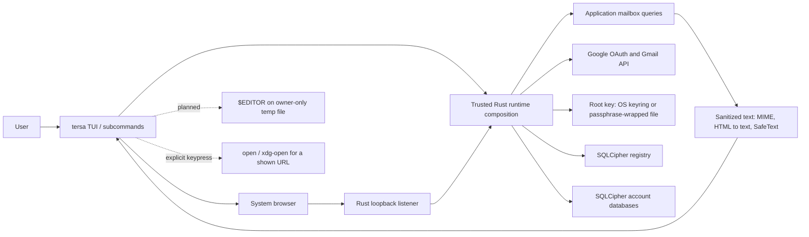

# Security data flow

Status values: **Implemented** (present in the tree), **Planned** (required
by [ADR 0031](../architecture/adr-0031-tui-only-pivot.md), not yet built),
**Closed** (must not receive data). Implemented describes source and automated
coverage, not live acceptance: two-real-account macOS isolation and offline
validation remain pending.

## End-to-end flow

## Flow inventory

| Flow | Data | Controls | Status |
|---|---|---|---|
| OAuth | Client ID/secret from user config, PKCE verifier, state, code, tokens | Loopback redirect, exact state check, PKCE S256, `id_token` audience/issuer/subject validation, identity gate | Implemented: PKCE, token lifecycle, identity gate (`tersa-application`), in-process token service (`tersa-token-broker-core`), IPv4 loopback listener and account flows (`tersa-sync-runtime`) |
| Gmail sync | Account-scoped IDs, headers, bounded raw bodies | Official Gmail REST API, identity gate, bounded pages/bodies, independent workers and status | Implemented: automatic startup/5-minute sync for every account; Ctrl-R follows the selected All/single-account view; opened bodies download on demand. History sync and mutations remain planned (T4) |
| Key hierarchy | Root key, HKDF-derived registry/account/dedup keys | OS keyring or Argon2id + XChaCha20-Poly1305 wrapped slot; owner-only, no-follow key file; zeroization | Implemented in `tersa-keys` and `tersa-vault`, used by `tersa` |
| Structured storage | Account-local envelopes, bodies, subject, refresh token, address, identity and freshness; registry of `(AccountId, dedup tag, position)` | Per-account SQLCipher/key, separate SQLCipher registry, exact schema validation, owner-only modes | Implemented (`tersa-store-sqlcipher`, used by `tersa-sync-runtime`); drafts/pending actions remain planned |
| Unified reading | Rows carrying `(AccountId, MessageId)`, per-account continuations and opaque unavailable states | Application query caps global pages at 200; deterministic merge; fresh scoped queries and stale-result rejection on view change | Implemented: All/single-account inbox via Tab / Shift-Tab; search filters loaded sanitized rows in memory, not FTS |
| Cache-only reset | One account's cached envelopes/bodies and sync freshness | Existing-only readonly preview, exact resolution, explicit confirmation/`--yes`, held installation lock, transactional clear then normal same-account sync | Implemented: `tersa account reset <account> [--yes]`; pre-clear refusal and committed-clear/sync-failure outcomes are distinct |
| Display | Headers, bodies, labels, filenames | Sanitizer strips control and bidi characters; HTML to text with limits; no remote fetch | Implemented: `tersa inbox` and the full-screen interface (T2b) display only `SafeText`; MIME decoding and a linear HTML-to-text converter (T2a); search runs in memory over sanitized rows and never leaves the process (T2c) |
| Composition | Draft plaintext | `$EDITOR` on an owner-only temp file removed afterwards; local-first draft in SQLCipher | Planned (T5) |
| Attachments | Attachment bytes | On-demand fetch, size limits, sanitized names, saved only on request, never auto-opened | Planned (T5–T6) |
| Logs | Counts, durations, error classes | No content, addresses, queries, tokens, or stable IDs | Redacted error types implemented |

## Cache reset boundary

Before confirmation, reset takes an existing private installation lock, unlocks
only an existing key and reads an authenticated readonly registry and mailbox
profile. Missing, unclaimed, insecure or unreadable state is refused without
bootstrap, claim, migration or permission repair. Unknown/ambiguous targets do
not select another account; an unreadable peer prevents a unique email match.
The only new file allowed is the owner-only coordination lock; existing SQLite
SHM bookkeeping may change.

After a completed `yes` line or explicit `--yes`, the same lock and installation
are retained for `Runtime::reset_cache`. There is no second key unlock, key
export or create-capable installation reopen. Generic store openers are not a
readonly capability and are excluded from preview. The existing-only clear
commits and drops its connection before the normal sync opens a writer.

Clear preserves account identity, subject, token, address, recovery metadata,
registry and keys; sync follows ordinary token rotation/revocation rules.
Pre-clear failure leaves cached mail intact. Post-clear sync failure is a
nonzero outcome that reports the committed clear and possible partial new
cache. This is logical cache deletion, not secure erasure, full-mailbox
restoration or the deferred incompatible-schema/new-ID/quarantine protocol in
[ADR 0026](../architecture/adr-0026-multi-account-and-unified-mailbox.md).

## Account worker shutdown

The terminal is restored before account workers are finalized. Shutdown signals
all workers, cancels owned futures and uses one shared cooperative grace period;
remaining native-call owners are retained and joined normally before releasing
the installation lock. Uninterruptible native calls can delay exit beyond that
grace period; no forced abort is used. Already-dispatched Tokio DNS work may
finish detached with no store state, retaining the existing DNS exception.

## Local persistence inventory

Every persistence surface is sensitive: databases, WAL and journal files,
cached bodies and attachments, composition temp files, configuration, and
logs. A new surface is blocked until its encryption, file mode, deletion, and
diagnostic behavior are recorded here.

## Closed boundaries

AI providers, MCP clients, OpenPGP, and any relay receive no data. Reopening
any of them requires an accepted ADR, a data-flow update, and security review.
