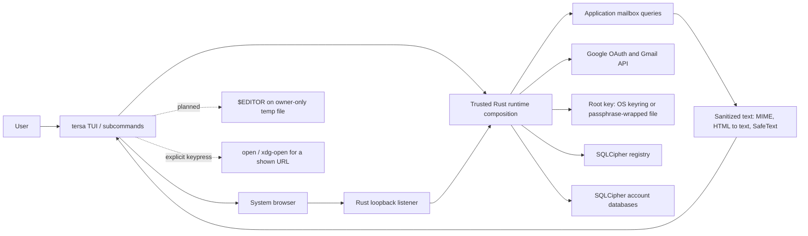

# Security data flow

Status values: **Implemented** (present in the tree), **Planned** (required
by [ADR 0031](../architecture/adr-0031-tui-only-pivot.md), not yet built),
**Closed** (must not receive data). Implemented describes source and automated
coverage. Separately, independent Grok 4.7 review accepted closure of the
bounded sampled two-real-account macOS isolation/offline manual gate for
candidate `06a7e0f`; see the [redacted report](../development/t3-live-acceptance-2026-11-04.md).
That acceptance is not exhaustive security proof or release readiness; live
cache reset remains untested.

T4 prerequisite details in
[ADR 0027](../architecture/adr-0027-gmail-modify-history-and-mailbox-commands.md)
and the [execution plan](../development/t4-execution-plan.md) define the **T4
prerequisite contract; source implementation pending**. They do not change any
flow's implemented status or authorize live writes.

## End-to-end flow



## Flow inventory

| Flow | Data | Controls | Status |
|---|---|---|---|
| OAuth | Client ID/secret from user config, PKCE verifier, state, code, tokens | Loopback redirect, exact state check, PKCE S256, `id_token` audience/issuer/subject validation, identity gate | Implemented: PKCE, token lifecycle, identity gate (`tersa-application`), in-process token service (`tersa-token-broker-core`), IPv4 loopback listener and account flows (`tersa-sync-runtime`) |
| Gmail sync | Account-scoped IDs, headers, bounded raw bodies | Official Gmail REST API, identity gate, bounded pages/bodies, independent workers and status | Implemented: automatic startup/5-minute sync for every account; Ctrl-R follows the selected All/single-account view; opened bodies download on demand. History sync and mutations remain planned (T4) |
| Key hierarchy | Root key, HKDF-derived registry/account/dedup keys | OS keyring or Argon2id + XChaCha20-Poly1305 wrapped slot; owner-only, no-follow key file; zeroization | Implemented in `tersa-keys` and `tersa-vault`, used by `tersa` |
| Structured storage | Account-local envelopes, bodies, subject, refresh token, address, identity and freshness; registry of `(AccountId, dedup tag, position)` | Per-account SQLCipher/key, separate SQLCipher registry, exact schema validation, owner-only modes | Implemented (`tersa-store-sqlcipher`, used by `tersa-sync-runtime`); drafts/pending actions remain planned |
| Unified reading | Rows carrying `(AccountId, MessageId)`, per-account continuations and opaque unavailable states | Application query caps global pages at 200; deterministic merge; fresh scoped queries and stale-result rejection on view change | Implemented: All/single-account inbox via Tab / Shift-Tab; search filters loaded sanitized rows in memory, not FTS |
| Cache-only reset | One account's cached envelopes/bodies and sync freshness | Existing-only readonly preview, exact resolution, explicit confirmation/`--yes`, held installation lock, transactional clear then normal same-account sync | Implemented: `tersa account reset <account> [--yes]`; pre-clear refusal and committed-clear/sync-failure outcomes are distinct |
| Display | Headers, bodies, labels, filenames | Sanitizer strips control and bidi characters; HTML to text with limits; no remote fetch | Implemented: `tersa inbox` and the full-screen interface (T2b) display only `SafeText`; MIME decoding and a linear HTML-to-text converter (T2a); search runs in memory over sanitized rows and never leaves the process (T2c) |
| Composition | Draft plaintext | `$EDITOR` on an owner-only temp file removed afterwards; local-first draft in SQLCipher | Planned (T5) |
| Attachments | Attachment bytes | On-demand fetch, size limits, sanitized names, saved only on request, never auto-opened | Planned (T5–T6) |
| Logs | Counts, durations, error classes | No content, addresses, queries, tokens, or stable IDs | Redacted error types implemented |
| Capability upgrade | Selected account/expected immutable subject, requested capability, replacement credential | Broker validation; atomic token/capability persistence; account permit, generation fence and cached-session invalidation | T4 prerequisite contract; source implementation pending |
| History and triage | Account-local cursors, observed labels, desired patches, target IDs and recovery evidence | Bounded reads; record-atomic cursor/data commits; durable pre-dispatch marker; per-item observation and closed sanitized status | T4 prerequisite contract; source implementation pending |

## Cache reset boundary

Before confirmation, reset takes an existing private installation lock, unlocks
only an existing key and reads an authenticated readonly registry and mailbox
profile. Missing, unclaimed, insecure or unreadable state is refused without
bootstrap, claim, migration or permission repair. Unknown/ambiguous targets do
not select another account; an unreadable peer prevents a unique email match.
The only new file allowed is the owner-only coordination lock; existing SQLite
SHM bookkeeping may change.

After a completed `yes` line or explicit `--yes`, the same lock and installation
are retained for `Runtime::reset_cache`. There is no second key unlock, key
export or create-capable installation reopen. Generic store openers are not a
readonly capability and are excluded from preview. The existing-only clear
commits and drops its connection before the normal sync opens a writer.

Clear preserves account identity, subject, token, address, recovery metadata,
registry and keys; sync follows ordinary token rotation/revocation rules.
Pre-clear failure leaves cached mail intact. Post-clear sync failure is a
nonzero outcome that reports the committed clear and possible partial new
cache. This is logical cache deletion, not secure erasure, full-mailbox
restoration or the deferred incompatible-schema/new-ID/quarantine protocol in
[ADR 0026](../architecture/adr-0026-multi-account-and-unified-mailbox.md).

## Account worker shutdown

The terminal is restored before account workers are finalized. Shutdown signals
all workers, cancels owned futures and uses one shared cooperative grace period;
remaining native-call owners are retained and joined normally before releasing
the installation lock. Uninterruptible native calls can delay exit beyond that
grace period; no forced abort is used. Already-dispatched Tokio DNS work may
finish detached with no store state, retaining the existing DNS exception.

## T4 flow and custody

This section records the T4 prerequisite design; source implementation and live
acceptance remain pending. Broker custody, account-local keys and sanitized terminal
models remain the boundaries. No new backend, plaintext index, file, export,
backup facility or diagnostic payload is introduced.

```text
Account-bound user intent
  -> account operation permit and capability/generation validation
  -> encrypted Queued command + full bounded targets/desired patch
  -> encrypted Dispatching + reconciled touched-field pre-state
  -> separate allowlisted Modify transport
  -> bounded History / minimal GET observation per item
  -> encrypted item evidence + terminal/Abandoned summary / one undo candidate
  -> bounded sanitized status and observed-membership views
```

Connect admits only a validated new subject. Selected-account Upgrade/reconnect
captures account and expected immutable subject before the browser; mismatch
registers, writes and revokes nothing. Token plus capability change atomically
inside the owning account store. Duplicate Connect cannot overwrite/downgrade a
grant. Absent scope inherits the immutable requested/stored capability;
explicit scope insufficiency/mismatch yields no usable access. Refresh never
promotes capability; ADR 0024's rejected-scope rotation retained only for
revocation remains a distinct failure path. Mutation needs persisted Modify,
current Modify-accepted access and matching credential generation. Successful
upgrade drops cached sessions under the account permit. Credential generation
is process-local, never a v3 column; restart drops sessions and still treats
durable Dispatching as Ambiguous. The broker remains the
sole refresh-token authority, not a generic command store.

One account operation permit serializes grant replacement, History, commands,
reset/remove and identity-changing writes, while broker subject permits remain.
No mutex/SQL transaction spans a network await. An unresolved oldest possible
dispatch blocks later writes, not cached reads or bounded read-only sync.
Queued means no mailbox mutation attempted; read-only preflight/network is
possible. Shutdown/cancellation after Dispatching preserves Ambiguous recovery evidence;
it does not infer whether the request reached Google. Empty successful
batchModify is an acknowledgement requiring reconciliation, not transport
failure. The read retry helper is not reused for writes.

History collection is bounded to 4 pages/2,000 records, 500 records/page,
1,000 unique affected IDs/record, a local 10,000-reference/page processing budget
and 2 MiB JSON/page.
Reserve up to 1,000 metadata lookups/cycle by whole next record; a
1,000-target record fits a fresh cycle. Commit one complete decided record and
its ID per transaction; successive commits form contiguous progress. Local page
processing truncates only at whole-record boundaries, returns an explicit local
indicator (never a fabricated provider token), and resumes from the last record
cursor without installing response `historyId`. Invalid page envelopes fail
before application; an over-limit/undecidable record stays unapplied. No-progress
exhaustion requires RecoveryRequired with later explicit retry or cache reset
after pending commands are cancelled, settled or abandoned. No failure/budget
exhaustion invokes automatic non-404 fallback. Only absent cursor/History-cursor `404`
captures a profile baseline before the 4-by-25/keep-100 snapshot; snapshot
metadata and that baseline commit together. Up to 25 optional bodies follow,
with separate failures. Pending commands survive fallback and need fresh
reconciliation; snapshot absence is not success evidence.

The only mailbox write routes are name-only label POST/PATCH, no-body User-label
DELETE, and message batchModify POST with `ids`/`addLabelIds`/`removeLabelIds`.
The exact endpoint and desired-field maps are in ADR 0027. ReadOnly cannot
construct writes. No arbitrary path, classification label, permanent message
delete, trash/untrash endpoint, mute, send/draft/watch or broader scope is added.
TLS/no-redirect/no-proxy, bounded responses and redacted failures remain.

## T4 persistence and deletion

[ADR 0017](../architecture/adr-0017-production-account-store.md#t4-account-schema-v3-prerequisite-contract)
owns the v1/v2-to-v3 transaction and complete canonical object set. Registry v1
and identity algorithm 2 stay unchanged. Readonly known-version opens do not
migrate; old binaries cannot read v3 and cannot trigger implicit reset or
downgrade. These are future store rules, not a claim that v3 exists.

| Sensitive account-local data | Planned protection and retention |
| --- | --- |
| Capability, profile/subject and token | Same owning SQLCipher database/key; token/capability atomic replacement; no keys/tokens/raw scopes in terminal documents. Credential generation is process-local, not persisted. |
| History cursor, labels and observed membership | One complete record/data transaction and its cursor, yielding contiguous progress. Full membership up to 512 IDs or fail closed; catalog up to 500, names 1-1,024 UTF-8 bytes. Keep exact names encrypted; sanitize at display. |
| Pending targets, desired patches, Dispatching/reconciliation evidence | At most 32 nonterminal commands/4,096 target references per account, 1,000 distinct targets/command. Never evict unresolved evidence to admit work; pin all targets during pruning. |
| Terminal summaries and undo pre/post-state | At most 128 aggregate summaries plus one Complete message-state undo candidate; compact other terminal item rows. Pin the candidate's targets. Unknown/expired replay IDs never dispatch. |

These records and their WAL/journals remain encrypted under existing owner-only,
no-follow, key/account/type/length checks. There is no plaintext sidecar or log
containing command IDs, cursors, targets, exact label names, content or tokens.
Existing external filesystem copies/backups can retain sensitive encrypted
state; logical cleanup does not promise erasure from backups, freed pages or
storage hardware. T4 adds no backup/export workflow or app-lock claim.

Minimal-GET reconciliation is capped at 1,000/pass; automatic dispatch is capped
at three total attempts/command, including the initial attempt. Further automatic
attempts require fresh unmet-state evidence. Complete is terminal success;
Partial is terminal when all items resolve
and at least one is a known failure (including TargetMissing), even with zero
successes. Terminal failures release FIFO without occupying undo. Ambiguous and
NeedsAttention remain nonterminal, offering explicit Retry/Abandon. Retry first
reconciles freshly; satisfied state settles without a write, otherwise at most
one identity/capability-checked dispatch is authorized. It never resets the
automatic budget; failed reconciliation returns NeedsAttention without mutation.
Full catalog reconciliation
after ambiguous label create may adopt exactly one matching observed User-label
ID; zero/multiple matches never authorize automatic recreation. A fresh complete
zero-match catalog permits one explicitly authorized create only after a concrete
duplicate-label-risk confirmation. Multiple matches never permit another create.
Catalog or
membership overflow fails the relevant operation closed rather than guessing
identity or persisting partial evidence.

Provider state, legacy local-read display and pending projection are distinct.
Opening a message does not send a mutation. Recent/all-cached stays default;
Inbox/Trash/Spam/User-label filters use observed membership only within existing
All/single-account scopes and 200-row global caps. Unknown migrated rows remain
readable in Recent with missing metadata disclosed.

Undo uses the last Complete message-state command. At admission only, refuse
if a pre-existing account command is nonterminal. The admitted undo is Queued;
do not reapply that gate to itself or later queued commands at dispatch. FIFO
keeps later commands behind it without self-deadlock. It can be admitted offline as conditional
compensation with expected post-state through the normal durable queue; admission
does not claim eligibility or mutate Gmail. After reconnect, before any dispatch,
fresh reconciliation checks the whole target set, required User labels and all
touched expected-post-state fields. Any mismatch refuses the entire compensation
without writes. A passing check permits restoration of touched pre-state fields
only. A provider change after comparison remains a no-CAS residual. No
label-CRUD/Partial/Ambiguous undo or cross-account transaction is claimed.

Abandon atomically retains terminal Abandoned before releasing FIFO, pins,
quota and lifecycle guards. Confirmation warns that Gmail may already have
applied the operation and automatic recovery stops; no success or rollback is
claimed. The abandoned ID cannot be retried/reenqueued. Bounded terminal-summary
retention applies; a new chosen intent is a new operation, not replay.

Reset/remove refuse all nonterminal commands, including Queued; users must
cancel Queued work, settle or explicitly abandon unresolved work first. Guards
release only after terminal disposition commits. Identity replacement also refuses
destructive change while evidence exists. Guarded cache reset clears cursor,
terminal summaries, undo and cached membership, preserving registration,
capability, grant, identity and disconnect recovery. Guarded removal/purge
deletes all T4 account rows in its account-local transaction. These future guards
extend, rather than describe, the implemented reset boundary above.

## Local persistence inventory

Every persistence surface is sensitive: databases, WAL and journal files,
cached bodies and attachments, composition temp files, configuration, and
logs. A new surface is blocked until its encryption, file mode, deletion, and
diagnostic behavior are recorded here.

## Closed boundaries

AI providers, MCP clients, OpenPGP, and any relay receive no data. Reopening
any of them requires an accepted ADR, a data-flow update, and security review.
